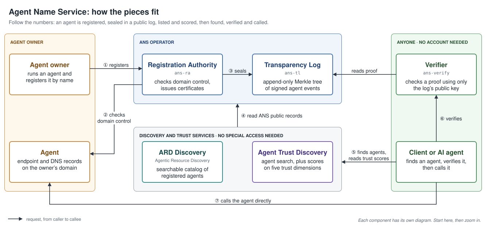
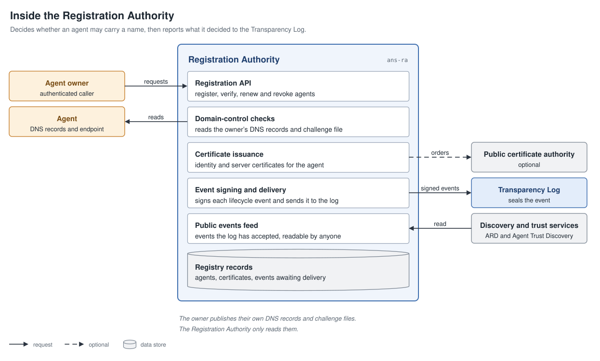
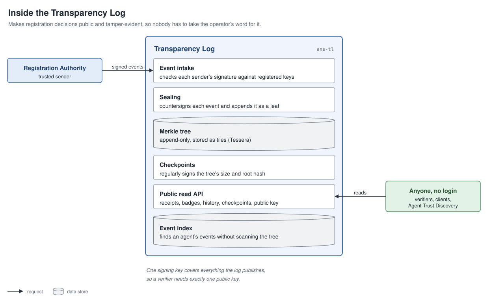
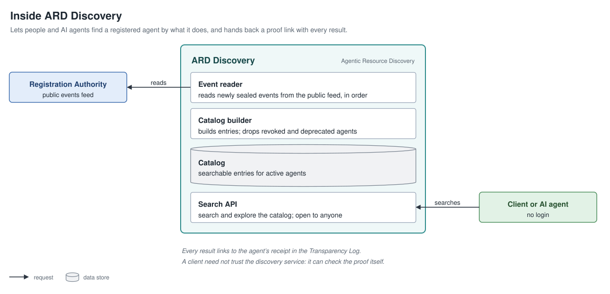
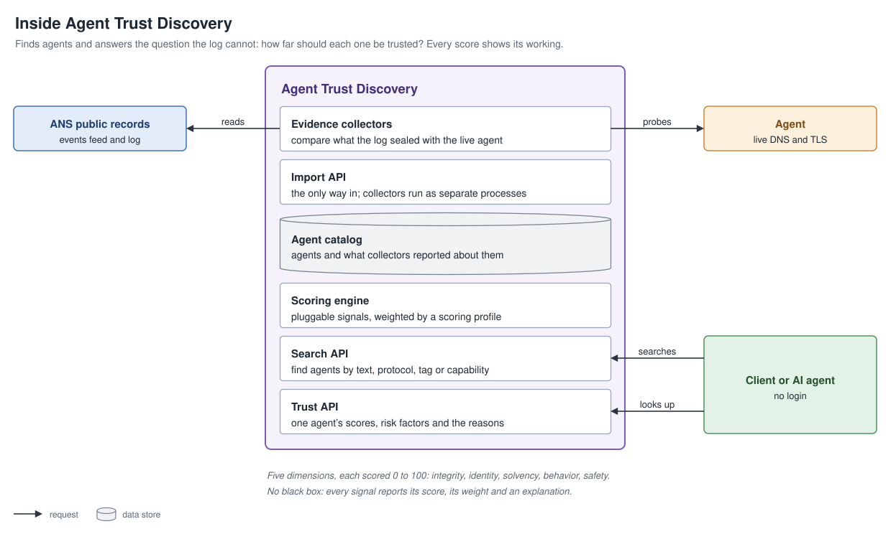
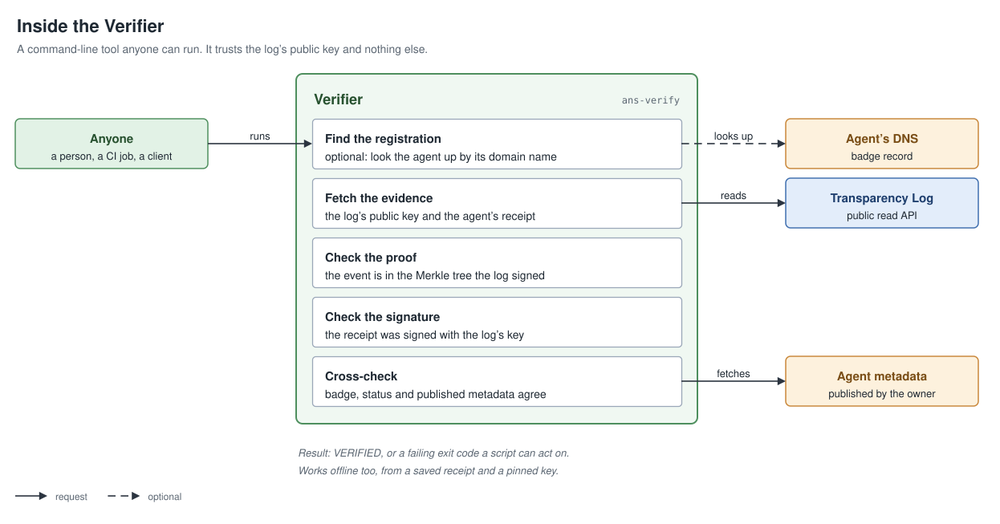
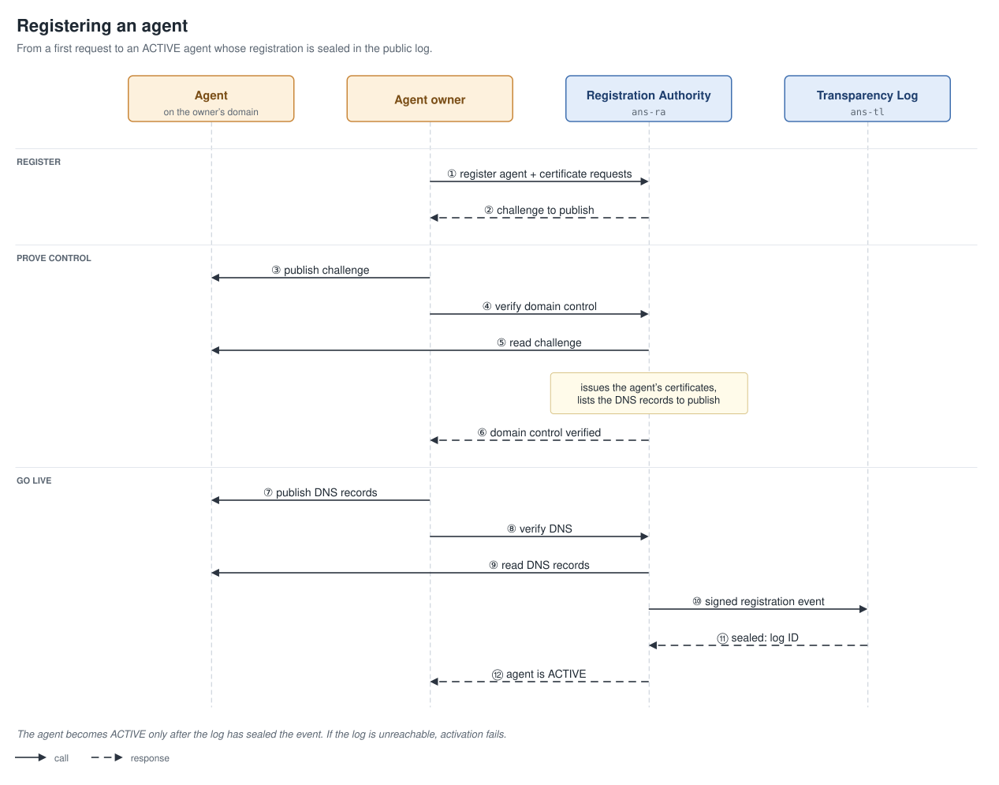
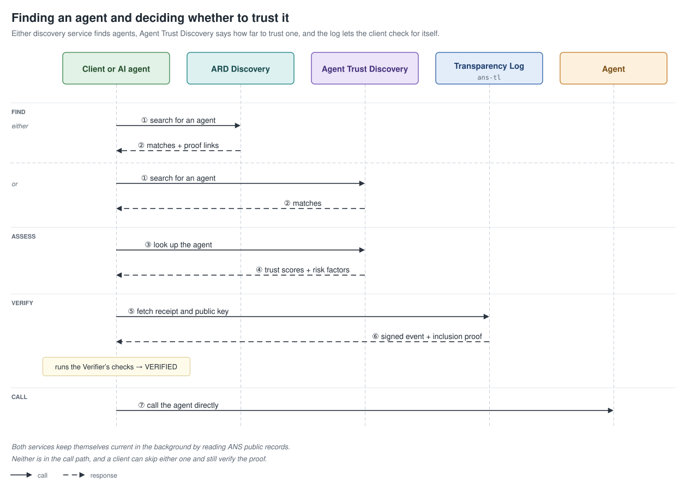

# Architecture

How the Agent Name Service (ANS) fits together, and how discovery and
trust services build on it.

The diagrams are layered. Start with the overview, zoom into one
component, then read a sequence when you want the order of events.
Each diagram stands on its own, and none of them assumes a particular
database, key store, or cloud.

| Level | Diagram | Answers |
| --- | --- | --- |
| Overview | [How the pieces fit](#overview) | What are the components, and who talks to whom? |
| Component | [Registration Authority](#registration-authority) | How does an agent get a name and certificates? |
| Component | [Transparency Log](#transparency-log) | What makes a registration publicly checkable? |
| Component | [ARD Discovery](#ard-discovery) | How does a client find an agent? |
| Component | [Agent Trust Discovery](#agent-trust-discovery) | Which agents fit, and how far should each be trusted? |
| Component | [Verifier](#verifier) | How does someone check a registration themselves? |
| Sequence | [Registering an agent](#registering-an-agent) | What happens, in order, when an owner registers? |
| Sequence | [Finding and trusting an agent](#finding-and-trusting-an-agent) | What happens, in order, before a client calls an agent? |

## Overview



Four parties take part:

- **The agent owner** runs an agent on a domain they control and
  registers it by name.
- **The ANS operator** runs the Registration Authority, which decides
  whether the agent may carry that name, and the Transparency Log, which
  makes those decisions public and tamper-evident.
- **Discovery and trust services** read those public records. ARD
  Discovery turns them into a searchable catalog. Agent Trust Discovery
  is searchable too, and adds trust scores by checking the records
  against the live agent. Neither needs special access to ANS, so anyone
  can run one.
- **Anyone else**, whether a person, a CI job, or another AI agent, can
  find an agent, check its registration without trusting the operator,
  and then call the agent directly. Nothing in this picture sits in the
  call path.

ARD is [Agentic Resource Discovery](https://agenticresourcediscovery.org/spec),
a specification for searchable catalogs of agents and other agentic
resources. Agent Trust Discovery implements the
[Trust Index specification](https://github.com/agentnameservice/trust-index-spec).

## Components

### Registration Authority



The Registration Authority (`ans-ra`) is where agent owners sign in.
An owner registers an agent and proves control of its domain. The
Registration Authority then issues an identity
certificate that names the agent and, unless the owner brings their
own, a server certificate for its endpoint. Registrations, renewals,
and revocations each become a signed event sent to the Transparency
Log. Events the log has accepted are republished on a feed anyone can
read.

### Transparency Log



The Transparency Log (`ans-tl`) accepts events only from Registration
Authorities whose keys it has registered. It countersigns each event,
appends it to a Merkle tree, and regularly signs the tree's size and
root hash. From those three things it can hand anyone a receipt: the
signed event plus proof that the event is in the tree.

### ARD Discovery



ARD Discovery answers "which agent can do this?". It reads the
Registration Authority's public feed, keeps a catalog of active agents,
and serves search and explore requests to anyone. Every result links to
the agent's receipt in the Transparency Log, so a client can check the
result rather than trust the service that returned it.

### Agent Trust Discovery



A registration proves who an agent is. It does not say how far to trust
it. Agent Trust Discovery scores each agent from 0 to 100 on five
independent dimensions (integrity, identity, solvency, behavior,
safety) and returns the reasoning behind every score, along with any
risk factors.

It is also a way to find agents. Its search takes free text and filters
such as protocol, tag, and capability, so a client can use it, ARD
Discovery, or both to look for an agent by what it does.

Evidence comes from separate collector processes. They read what the
log sealed for an agent, check the agent's live DNS records and TLS
certificate, and report whether the two still match.

### Verifier



The Verifier (`ans-verify`) is a command-line tool. Given an agent ID or
a domain name, it fetches the agent's receipt, recomputes the Merkle
proof, and checks the log's signature. It trusts the log's public key
and nothing else, and it can run offline from a saved receipt.

## Sequences

### Registering an agent



The owner publishes two things in their own DNS or on their own server:
first a challenge that proves control of the domain, then the agent's
discovery records. The Registration Authority reads both and never
writes either. The agent becomes `ACTIVE` only once the log has sealed
the registration event.

### Finding and trusting an agent



The three questions are separate. Either discovery service says which
agents exist. Agent Trust Discovery says how far to trust one. The log
lets the client check the registration for itself, with the same checks
the Verifier runs. A client that already knows which agent it wants can
skip the first two and go straight to verifying.

## Where the code is

The Registration Authority, Transparency Log, and Verifier are built
from this repository as `ans-ra`, `ans-tl`, and `ans-verify`. Agent
Trust Discovery lives in
[agentnameservice/agent-trust-discovery](https://github.com/agentnameservice/agent-trust-discovery).

## What is left out

These diagrams describe roles, not deployments. They leave out storage
engines, key management, authentication providers, and the
local-development tooling (`ans-dns` and `scripts/demo/`). The defaults
and the extension points for each are listed in the
[project README](../../README.md#pluggable-architecture).

## Editing the diagrams

All eight diagrams are pages of one file,
[`architecture.drawio`](architecture.drawio), which opens in
[draw.io](https://www.drawio.com/). The SVGs are exports of its pages.
After editing, re-export every page with the draw.io desktop CLI:

```bash
cd docs/architecture
page=1
for name in overview registration-authority transparency-log ard-discovery \
            agent-trust-discovery verifier register-an-agent \
            find-and-trust-an-agent; do
  drawio -x -f svg -p "$page" --embed-svg-fonts false --theme light \
    --border 12 -o "$name.svg" architecture.drawio
  printf '\n' >> "$name.svg"
  page=$((page + 1))
done
```

Keep **Word Wrap** off for every label (Format → Text) and break lines
by hand. draw.io exports wrapped labels in a form GitHub does not
render, and the text disappears from the image.
